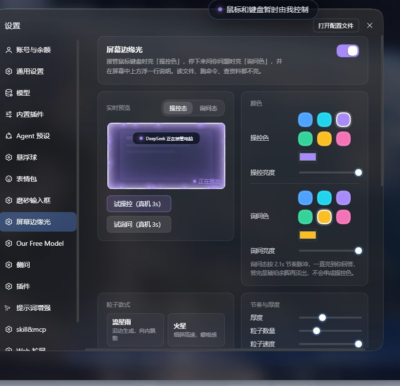
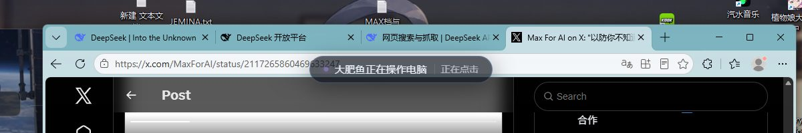
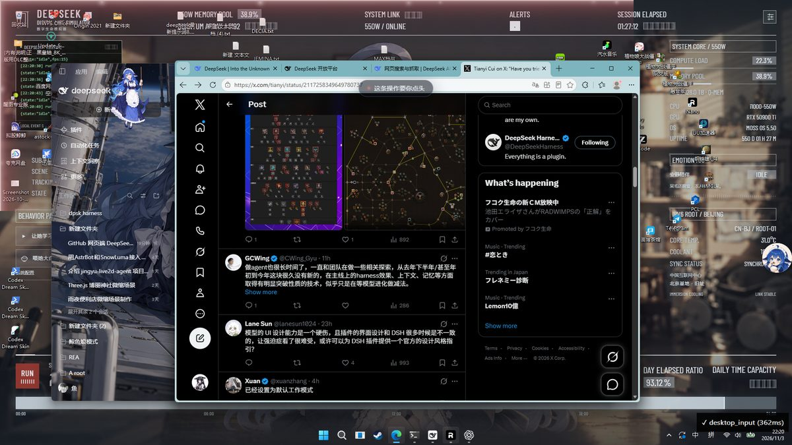
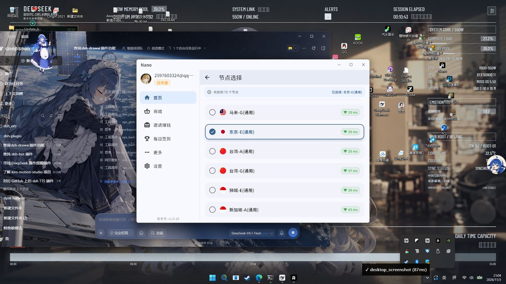

# dsh-screen-glow

模型 **真的接管你的鼠标/键盘** 时，主屏四边亮起蓝色呼吸光并飘起粒子；想事情、读文件、跑命令、查资料、浏览器自动化都不亮。

> 生态里现成的边缘光插件（dsh-moon-light / dsh-rimlight / dsh-fleeting-light）只画在 DSH 网页窗口里，你切到别的应用就看不见。
> 这个是 **OS 级全屏透明置顶窗**，盖在所有窗口之上，只在"抢鼠标"那一刻亮。


## 截图

| 设置页（两栏卡片 + 句子胶囊 + 实时预览） | 提示条：提示语 + 当前动作 |
|---|---|
|  |  |

| 批准态（红色急脉冲，等你点头） | 粒子款式「环流」 |
|---|---|
|  |  |


## 效果

- 主屏四边：多层内辉光（贴边亮核 + 向内渐隐），四角更亮
- 粒子：沿四条边生成、向内飘散，蓝白色，`lighter` 叠加
- 呼吸：约 3.9s 一个周期；每次工具切换会有一个小亮度上顶（你能看出"它刚点了一下"）
- 熄灭：最后一次操控结束后 1.6s 淡出（连续操作不会闪）
- 只覆盖**主屏**；不抢焦点、不挡点击（`setIgnoreMouseEvents` + `showInactive`）

## 什么算「接管电脑」

| 分类 | 工具（子串匹配，默认） | 行为 |
|---|---|---|
| 点亮 | `desktop_mouse` `desktop_input` `desktop_mouse_drag` `desktop_window_activate` `desktop_window_move` `desktop_window_resize` `computer_` `mouse_` `keyboard_` `bsk_` | 光起 |
| 续命 | `desktop_screenshot` `desktop_perceive` `desktop_vision` `desktop_windows_list` `desktop_window_info` `desktop_screen_size` `desktop_clipboard_*` | 只在已亮时延长 |
| 不亮 | 读写文件、bash、web 搜索、browser CDP 自动化、todo… | 一点不亮 |

细节：`desktop_mouse` 的 `action:"position"`（只读一下光标位置）不算接管，不点亮。
这些清单都能在 `cordis.patch.yml` 里改。

## 安装

```sh
dsh plugin --profile web add dsh-screen-glow
```

或从仓库：

```sh
dsh plugin --profile web add github:<you>/dsh-screen-glow
```

需要的 Electron：按以下顺序查找 `overlay.electronPath` → `DSH_SCREEN_GLOW_ELECTRON` → `DSH_ELECTRON_PATH` → `$DSH_HOME/electron/electron[.exe]` → `~/.dsh/electron/electron[.exe]`。
DSH 桌面端/装过 dsh-pet 的机器上通常已经有了；找不到时插件其余部分照常工作，只记一条 warn。


## 自检 CLI（0.5.0）

装好后可直接用 `dsh-screen-glow <命令>`；没装到 PATH 时用 `node <插件目录>/lib/cli.mjs`。

```bash
dsh-screen-glow doctor                  # 全量自检（人读）
dsh-screen-glow doctor --json           # 机器读
dsh-screen-glow status                  # 一行 JSON 状态
dsh-screen-glow hide 60000              # 紧急熄灯 60 秒
dsh-screen-glow preview 3000 pending    # 真机试亮 3 秒（control|ask|pending）
```

`doctor` 检查 11 项：profile/HOME、数据目录、settings.json 合法性与提示语条数、state.json 新旧、覆盖层进程存活与运行时长、全局快捷键是否注册成功、Electron 可执行路径、HTTP 接口连通性、boot.log 大小。任一项失败时退出码为 1，并给出具体修复动作。

依赖两个状态文件（插件自动写）：

| 文件 | 写入方 | 内容 |
|---|---|---|
| `~/.dsh/screen-glow/overlay.status.json` | 覆盖层进程 | pid、启动时间、快捷键与注册结果、Electron 版本、静音截止 |
| `~/.dsh/screen-glow/endpoint.json` | 宿主 | HTTP origin / 端口（来自 `webServer.getOrigin()`） |

## 可靠性（0.3.0）

- **看门狗**：每 5 秒检查覆盖层，挂了自动重拉（退避 5s→120s，最多 5 次）。设置项 `watchdog`。
- **紧急熄灯**：`Ctrl+Alt+G` 立即隐藏 60 秒（再按恢复）；或设置页点「立即熄灯 60s」（走 `POST /screen-glow/hide`）。
- **提示条动作**：提示语后面实时追加「正在点击 / 正在看屏幕 / 正在输入文字」，让余光扫一眼就知道在干什么。设置项 `bannerAction`。

## 三种光态（0.4.0）

| 光态 | 触发 | 默认色 | 节奏 |
|---|---|---|---|
| 操控 | 接管鼠标/键盘 | 星蓝 `#4da3ff` | 3.9s 呼吸 |
| 询问 | `ask_user_question` | 琥珀 `#fbbf24` | 2.1s 脉冲 |
| **批准** | `approval/request`（要你点头的红线操作） | **红 `#f87171`** | **1.4s 急脉冲** |

提示条可显示「会话「工作目录名」」，多会话并行时能分清是谁在操作；日志超过 256 KB 自动滚动。

## 两种光态（颜色各自独立）

| 光态 | 触发 | 默认色 | 节奏 |
|---|---|---|---|
| 操控态 | 模型接管鼠标/键盘（`desktop_mouse` / `desktop_input` / drag / 抢焦点…） | 星蓝 `#4da3ff` | 3.9s 慢呼吸 |
| 询问态 | 模型停下来问你问题（`ask_user_question`）、等你批准（`approval/request`） | 琥珀 `#fbbf24` | 2.1s 快脉冲，一直亮到你回答 |

询问态结束后会回到操控色的余晖，再按「停留时长」自然熄灭。


## 屏幕提示条（中上方一行字）

操控态和询问态都会在**屏幕中心偏上**浮一个圆角提示条（磨砂黑底 + 主色点 + 一句话），一直亮着时**每 7 秒随机换一句**。

| 项 | 默认值 | 说明 |
|---|---|---|
| 开关 | 开 | 设置页「屏幕提示条 → 显示中/已隐藏」 |
| 垂直位置 | 18% | 6%–60% 滑杆 |
| 字号 | 15px | 11–28 滑杆 |
| 操控提示语 | 5 句 | 一行一句，随机轮换，最多 12 句、每句 60 字 |
| 询问提示语 | 5 句 | 同上 |

默认操控语：`DeepSeek 正在接管电脑` / `鼠标和键盘暂时由我控制` / `正在替你操作电脑，先别抢鼠标` / `DeepSeek 正在执行桌面操作` / `我在点东西，手先别动`

默认询问语：`DeepSeek 在等你回复` / `请回复一下最新提问` / `等你选一下，我才能继续` / `有个问题需要你拍板` / `看一下消息，我等你`

提示条与边缘光同源：熄灭时一起淡出，询问态用琥珀描边、操控态用主色描边。

## 粒子款式（5 种）

| key | 名字 | 手感 |
|---|---|---|
| `stream` | 流星雨 | 沿边生成、向内飘散（默认） |
| `spark` | 火星 | 细碎、高速、噼啪感 |
| `dust` | 尘埃 | 缓慢、大颗、很淡 |
| `orbit` | 环流 | 沿屏幕边框绕圈流动 |
| `none` | 无 | 只要边缘光 |

## 设置页（浏览器半侧）

DSH **设置 → 屏幕边缘光**：操控色 / 询问色两套（各 6 个预设 + 任意取色器、独立亮度）、粒子款式、厚度、粒子数量、粒子速度、停留时长，
全部带**实时预览**（预览用的就是覆盖层同一套发光公式），底下还有「试一下（真机 3 秒）」直接点亮桌面验证。

设置存在宿主机 `~/.dsh/screen-glow/settings.json`，换浏览器 / 重启 DSH 都保留；改完立刻推给正在运行的覆盖层，不用重开。

数据通路：

```
设置页 ──PUT /screen-glow/settings──▶ 宿主（落盘 + 改写 state.json 的 look）
      ──POST /screen-glow/preview──▶ 宿主强制试亮 N 秒
覆盖层 ──每 100ms 读 state.json──▶ 换色 / 换厚度 / 换粒子数
```

### HTTP 接口

| 方法 | 路径 | 作用 |
|---|---|---|
| GET | `/screen-glow/settings` | 读当前设置（含规范化后的 look） |
| PUT/POST | `/screen-glow/settings` | 保存设置（字段自动 clamp，非法值回落默认） |
| POST | `/screen-glow/preview` | 真机试亮，body `{"ms":3000}`（400–10000） |

## 配置

```yaml
- id: dsh-screen-glow
  name: 'dsh-screen-glow'
  config:
    enabled: true
    holdMs: 1600        # 一次操作后光再停留多久
    minOnMs: 420        # 单次点亮最短时长
    maxOnMs: 300000     # 安全上限
    look:
      color: '#4da3ff'  # 主色
      thickness: 1      # 光带厚度倍率 0.3..3
      intensity: 0.9    # 亮度 0.15..1
      particles: 80     # 粒子上限 0..260
      speed: 1          # 粒子速度 0.2..3
    trigger: [desktop_mouse, desktop_input, ...]
    extend: [desktop_screenshot, desktop_perceive, ...]
    electronPath: ''
    dataDir: ''         # 默认 $DSH_HOME/screen-glow
```

## 排障

| 现象 | 处理 |
|---|---|
| 一点光都没有 | 看宿主日志有没有 `overlay not running (electron-not-found)`；把 Electron 路径写进 `electronPath` |
| 光在但没粒子 | 系统开了「减弱动效」时只画静态光（预期行为） |
| 透明窗发黑/花屏 | 设 `DSH_SCREEN_GLOW_SOFTWARE=1` 走软件合成重开 |
| 想看状态 | `cat "$DSH_HOME/screen-glow/state.json"`；`overlay.pid` 是覆盖层进程 |

## 安全边界（静态扫描说明）

扫描器通常会报一条 `child-process` 警告。这里说明它具体做什么，以及它**不能**做什么。

**唯一的子进程调用**在 `lib/index.js`：

```js
const child = spawn(binary, [join(HERE, 'overlay', 'main.cjs')], {
  detached: true,
  stdio: 'ignore',
  windowsHide: true,
  env,
})
```

| 约束 | 说明 |
|---|---|
| 不使用 shell | 没有 `shell: true`，也不是 `exec/execSync` 拼字符串；参数以 argv 数组传递，不存在命令注入面 |
| 二进制来源 | 本机配置 `overlay.electronPath` → 环境变量 → 固定候选（`$DSH_HOME/electron/electron.exe`、`~/.dsh/electron/electron.exe`），不来自模型或网络 |
| 脚本参数 | 模块自身目录下的 `overlay/main.cjs`，由 `join(HERE, ...)` 推导，外部不可替换 |
| 用途 | 宿主不是窗口进程，覆盖层必须由一个独立 Electron 进程绘制全屏透明置顶窗（边缘光/提示条） |
| 输出 | `stdio: 'ignore'`，不读取、不回传子进程输出 |
| 生命周期 | `detached` + 父 pid 看门狗，宿主退出时随之退出；不下载外部程序、不提权 |

仓库内其余 `.exec` 出现处均为正则匹配（`/^mcp__.*?__/`、`/:(\d+)/`），与命令执行无关。

0.5.1 起不再调用 `process.kill`、也不再 `unlink` 任何文件：覆盖层存活判定用**心跳文件**（覆盖层每 2 秒写 `overlay.status.json` 的 `beat`；宿主每 5 秒写 `host.heartbeat`），退出用**请求式**（宿主写 `shutdown.json`，覆盖层自行 `app.quit()`）；pid 文件清空是写入空串而不是删除。

**网络与数据**：无遥测、无外部请求；HTTP 路由（`/screen-glow/settings`、`/screen-glow/preview`、`/screen-glow/hide`）只注册在宿主 webServer 的本机监听地址上，用于同源的设置页读写。覆盖层只读本地 `state.json`（布尔值 + 工具名 + 几个数字）。

## 隐私

不联网、无遥测、不截图、不读屏幕内容。覆盖层只读一个本地 `state.json`（布尔值 + 工具名 + 几个数字）。

## 许可

MIT
