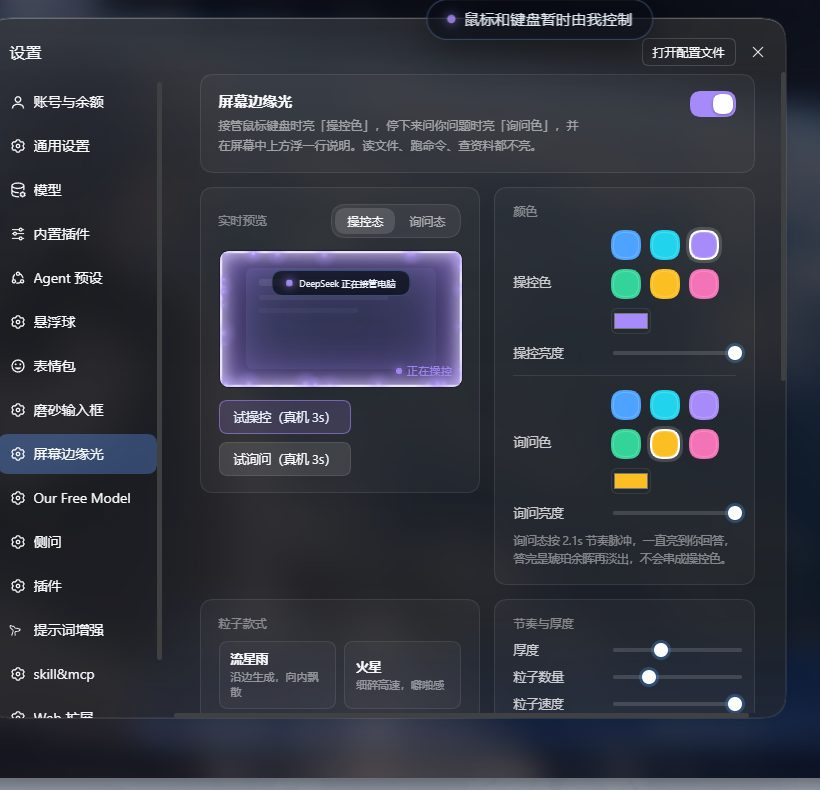
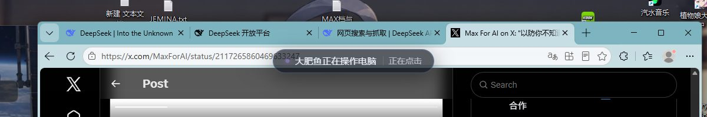

模型接管你的鼠标键盘时，主屏四边亮起呼吸光；停下来问你问题、等你批准时各有颜色；屏幕中上方浮一行「正在做什么」。**只在真的动输入时亮**，读文件、跑命令、查资料不亮。

## 安装

```bash
# GitHub 直装
dsh plugin --profile desktop add github:Ravi666688/dsh-screen-glow

# 或用本页附件里的 tgz
dsh plugin --profile desktop add file:C:/path/to/dsh-screen-glow-0.5.0.tgz
```

装完重启 DSH，在 **设置 → 屏幕边缘光** 里调颜色、粒子、提示语；`Ctrl+Alt+G` 随时熄灯 60 秒。

## 三种光态

| 光态 | 触发 | 默认色 | 节奏 |
|---|---|---|---|
| 操控 | `desktop_mouse` / `desktop_input` / 抢焦点 | 星蓝 `#4da3ff` | 3.9s 呼吸 |
| 询问 | `ask_user_question` | 琥珀 `#fbbf24` | 2.1s 脉冲 |
| 批准 | `approval/request` | 红 `#f87171` | 1.4s 急脉冲 |

## 这一版包含

- 边缘光 + **5 种粒子款式**（流星雨 / 火星 / 尘埃 / 环流 / 无），数量、速度、厚度、亮度全可调
- **屏幕中上方提示条**：轮换提示语（可自己增删句子）+ 实时动作文案（「正在点击」「正在看屏幕」）+ 会话名
- **设置页**：两栏卡片、句子胶囊、实时预览（与真机同一套发光公式）、三态试亮
- **可靠性**：覆盖层看门狗（挂了 5 秒内自动重拉）、`Ctrl+Alt+G` 紧急熄灯、日志 256 KB 自动滚动
- **自检 CLI**：`doctor`（11 项检查）、`status`、`hide`、`preview`

## 截图





## 已知限制

- 只覆盖**主屏**；UAC 安全桌面和独占全屏游戏盖不住（系统限制）
- 需要本机有 Electron（`~/.dsh/electron/electron.exe`，装过 dsh-pet 一般就有；也可在配置里指定 `overlay.electronPath`）
- 实测兼容 DSH `0.2.1-rc.5`

完整变更见 [CHANGELOG.md](https://github.com/Ravi666688/dsh-screen-glow/blob/main/CHANGELOG.md)；路线图见 [docs/ROADMAP-v0.3.md](https://github.com/Ravi666688/dsh-screen-glow/blob/main/docs/ROADMAP-v0.3.md)。
